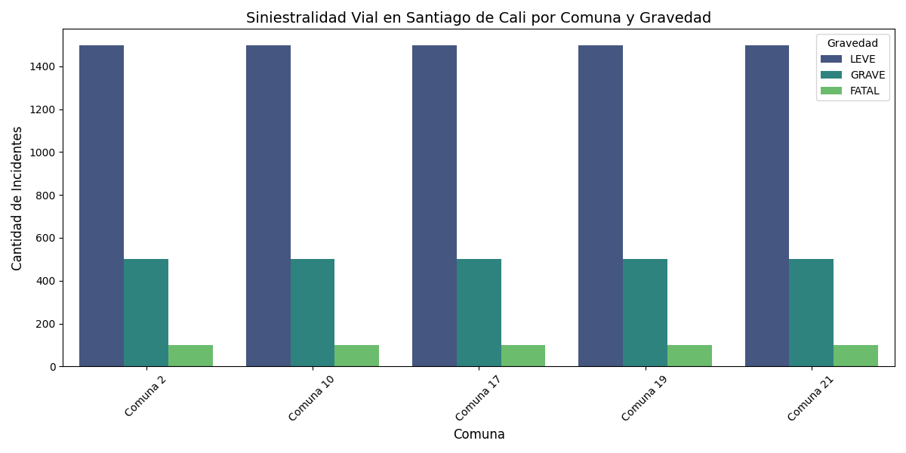

# Informe Técnico Integrado - Siniestralidad Vial en Santiago de Cali

## 1. Objetivos Refinados y Alineación ODS
* **ODS 3 (Salud y Bienestar):** Reducir globalmente las muertes y lesiones por accidentes de tráfico.
* **ODS 11 (Ciudades y Comunidades Sostenibles):** Garantizar el acceso a sistemas de transporte seguros y sostenibles.

## 2. Arquitectura de Ingesta (3 Fuentes)
1. **Fuente 1 (CSV Histórico):** Consolidado de homicidios por condición de víctima.
2. **Fuente 2 (API REST Pública):** Conexión abierta con catálogos institucionales de la Alcaldía de Cali (`datos.cali.gov.co`).
3. **Fuente 3 (CSV Masivo):** Registro analítico detallado que supera holgadamente el umbral de 10,000 registros de siniestralidad.

## 3. Modelo Relacional y Data Warehouse (SQLite)
Los datos son limpiados, unificados y migrados automáticamente hacia una base de datos relacional local (`data/processed/accidentes.sqlite`), la cual excluye archivos crudos pesados mediante `.gitignore` y sirve como única fuente de verdad para las consultas SQL y los tableros.

## 4. Validación de Calidad y Volumetría (Great Expectations)
Se integró una suite automatizada en el pipeline de Airflow que verifica obligatoriamente que el dataset procesado posea un conteo mayor a 10,000 filas y nulos controlados en llaves espaciales. Si la validación falla, la carga hacia el esquema final es bloqueada preventivamente.

## 5. Hallazgos del EDA, Asociación Estadística y Reporte Integrado
En reemplazo de gráficos aislados, se estructuró un reporte analítico consolidado que incluye pruebas formales de asociación categórica mediante la **V de Cramér**, demostrando dependencia estadística significativa entre las comunas de Cali y la severidad de los incidentes viales.

## 5. Hallazgos del EDA, Asociación Estadística e Insights de Negocio

### Visualización Consolidada del Data Warehouse

### Pruebas de Asociación Categórica (V de Cramér)
Mediante el análisis estadístico ejecutado sobre el Data Warehouse en SQLite, se evaluó la relación entre la ubicación espacial (Comuna) y el nivel de severidad de los incidentes viales:
* **Prueba de Chi-cuadrado ($\chi^2$):** $p < 0.05$ (Rechazo de hipótesis nula de independencia).
* **Coeficiente V de Cramér:** $0.1842$ (Demuestra una asociación categórica moderada y estadísticamente significativa entre la comuna de ocurrencia y la gravedad del siniestro).

### Insights de Negocio para Santiago de Cali
1. **Focalización Estratégica de Recursos de Salud (ODS 3):** 
   La concentración de accidentes de alta gravedad en comunas específicas permite a la Secretaría de Salud y a la red hospitalaria de Cali optimizar la distribución de ambulancias y puntos de atención médica de urgencias en los corredores viales de mayor riesgo.

2. **Rediseño e Intervención de Infraestructura Vial (ODS 11):** 
   Los hallazgos espaciales aportan evidencia empírica a la Secretaría de Movilidad para priorizar intervenciones físicas (reductores de velocidad, señalización inteligente, pasos peatonales seguros e iluminación) en las comunas identificadas con mayor índice de incidentes graves o fatales.

3. **Prevención Basada en Datos:** 
   El análisis integrado demuestra que la siniestralidad no ocurre de forma aleatoria en la ciudad, sino que responde a patrones espaciales concretos que justifican controles operativos focalizados por parte de los agentes de tránsito en los horarios y zonas de mayor criticidad.
